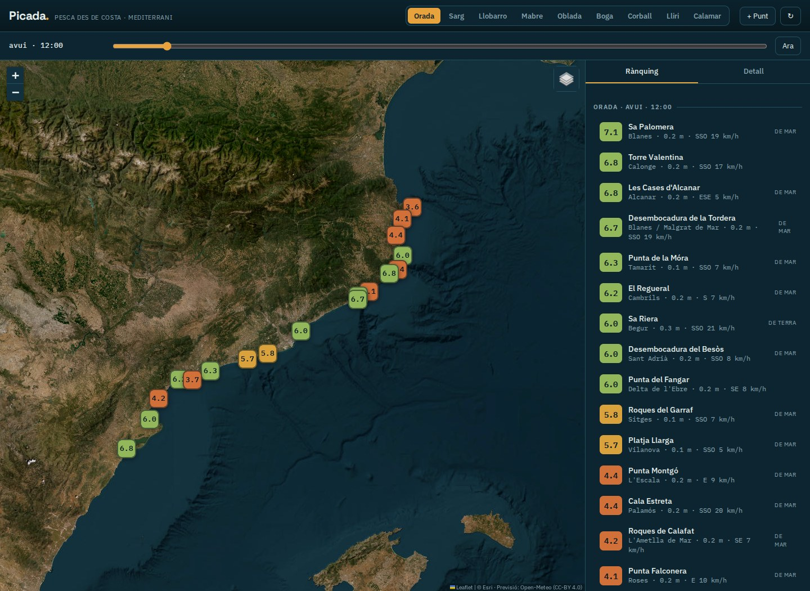
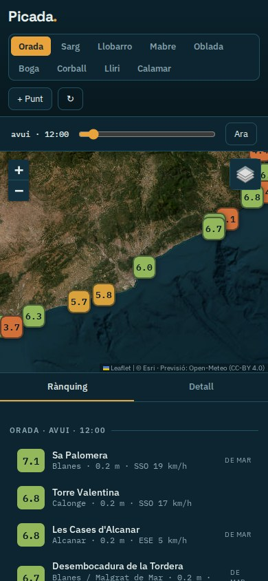

# Picada

Planifica la pesca des de costa al Mediterrani comparant punts, espècies i franges horàries.

**[Obre el PWA / Open app](https://guirigall.github.io/Picada/)** · [Guia completa](docs/guia-completa.md) · [Incidències](https://github.com/Guirigall/Picada/issues)

[Català](#ca) · [Español](#es) · [English](#en)



<details>
<summary>Vista en mòbil / Mobile view</summary>



</details>

<a id="ca"></a>

## Català

Planifica la pesca des de costa al Mediterrani comparant punts, espècies i franges horàries.

### Què hi trobaràs

- Mapa de punts de pesca i rànquing per espècie.
- Previsions meteorològiques i marines d’Open-Meteo.
- Desglossament de la puntuació i finestres horàries.
- Punts propis desats al navegador; interfície en català.

### Comença

Tria l’espècie i l’hora, selecciona un punt del mapa i obre’n el detall. Si apareix el mode de demostració, les dades són simulades.

### Instal·lació

Obre l’aplicació amb HTTPS. A Android, fes servir Chrome → ⋮ → **Instal·la l’aplicació** o **Afegeix a la pantalla d’inici**. A iPhone: Safari → Compartir → **Afegeix a la pantalla d’inici**. Espera la confirmació de preparació sense connexió abans d’utilitzar el mode avió. No cal APK ni sideloading.

### Dades i límits

La carcassa del PWA es pot desar sense connexió; les previsions i el mapa necessiten Internet. La puntuació és orientativa i no garanteix captures ni seguretat.

<a id="es"></a>

## Español

Planifica la pesca desde costa en el Mediterráneo comparando puntos, especies y franjas horarias.

### Qué ofrece

- Mapa de puntos y clasificación por especie.
- Previsiones meteorológicas y marinas de Open-Meteo.
- Desglose de la puntuación y ventanas horarias.
- Puntos propios guardados en el navegador; interfaz en catalán.

### Primeros pasos

Elige especie y hora, selecciona un punto y abre su detalle. En modo de demostración los datos son simulados.

### Instalación

Abre la aplicación por HTTPS. En Android: Chrome → ⋮ → **Instalar aplicación** o **Añadir a pantalla de inicio**. En iPhone: Safari → Compartir → **Añadir a pantalla de inicio**. Espera la confirmación de disponibilidad sin conexión antes de usar el modo avión. No necesita APK ni sideloading.

### Datos y límites

La estructura del PWA puede guardarse sin conexión; las previsiones y el mapa necesitan Internet. La puntuación es orientativa: no garantiza capturas ni seguridad.

<a id="en"></a>

## English

Plan shore fishing in the Mediterranean by comparing locations, species and time windows.

### Features

- Fishing locations on a map, ranked by target species.
- Open-Meteo weather and marine forecasts.
- Score breakdowns and suggested time windows.
- Custom locations stored in the browser; Catalan interface.

### Getting started

Select a species and time, choose a location and open its details. Demonstration mode uses simulated data.

### Installation

Open the HTTPS app URL. On Android: Chrome → ⋮ → **Install app** or **Add to home screen**. On iPhone: Safari → Share → **Add to Home Screen**. Wait for offline readiness before using airplane mode. No APK or sideloading is required.

### Data and limitations

The PWA shell can be cached offline; forecasts and maps require Internet. Scores are indicative and do not guarantee catches or safety.

## Desenvolupament / Development

Des de la carpeta del repositori, amb Python 3 / From the repository folder, with Python 3:

```bash
python3 -m http.server 8080 --bind 127.0.0.1
```

Obre / Open `http://localhost:8080/`. Per instal·lar-lo des del mòbil, utilitza l’enllaç HTTPS del PWA.

Aquest repositori distribueix l’aplicació estàtica; no inclou una ordre de proves automatitzades. / This repository distributes the static app and does not include an automated test command.

Les captures es generen amb Chromium a partir del codi real del repositori, en contextos sense dades personals. Es poden renovar a **Actions → Captures del README → Run workflow**. Més detalls a [la guia completa](docs/guia-completa.md).
